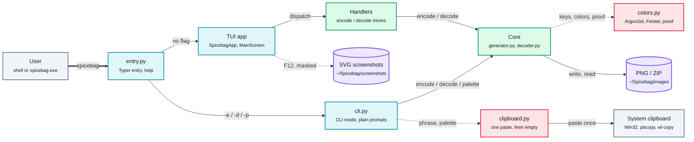

# Architecture

How Spicebag is put together, for anyone modifying it. The [README](../README.md) covers what the encoding does and why the numbers are what they are; this document covers where the code lives and which parts you can break without noticing.

---

## Layers

The package splits into `frontend/`, everything the user sees, and `backend/`, the engine. Each layer calls only downward and `backend/` never imports `frontend/`; the platform helpers in `frontend/utils/` serve the TUI app and CLI mode:

```
Entry  →  TUI app / CLI mode  →  Handlers  →  Core  →  Constants
```



```
spicebag/
├── __main__.py             python -m spicebag, and the entry script of spicebag.exe
├── frontend/
│   ├── entry.py            Typer entry point
│   ├── cli.py              CLI mode, the --encode, --decode and --palette prompts
│   ├── tui.py              SpicebagApp, the Textual application root
│   ├── tui.tcss            stylesheet (shipped as package data)
│   ├── theme.py            palette, banner art, AppState, output folders, input limits
│   ├── tree.py             history tree model and renderer, emits styled Text lines
│   ├── screenshot.py       SVG export with secret masking
│   ├── screens/
│   │   ├── warning.py      WarningScreen, the 4-key security confirmation
│   │   ├── main.py         MainScreen, the state machine
│   │   └── help.py         HelpScreen, the in-app reference
│   ├── handlers/
│   │   ├── encode.py       EncodeHandlerMixin
│   │   └── decode.py       DecodeHandlerMixin
│   ├── widgets/
│   │   ├── secureInput.py  Input that filters typing and pasting per state
│   │   ├── stripLog.py     scrolling view over pre-rasterized Strips
│   │   └── optionsBar.py   status bar
│   └── utils/
│       ├── clipboard.py    per-OS clipboard read, clear and one-paste write
│       ├── networkDetect.py  per-OS connection state, packet-free
│       ├── terminalColors.py live terminal palette probe, per-OS
│       └── limitedTerminal.py limited terminal detection for the header notice
└── backend/
    ├── colors.py           key derivation, the color transform, the proof of phrase
    ├── generator.py        encode, bulk encode, interactive ColorSpace
    ├── decoder.py          PNG validation, decode
    ├── paths.py            save and image path parsing, filename validation
    └── defaults.py         wordlists, standards, grid sizes, forbidden PNG chunks, Feistel rounds
```

### Entry point (`frontend/entry.py`)

Typer app whose callback launches the TUI app, alongside five eager flags: `--encode` / `-e`, `--decode` / `-d` and `--palette` / `-p` run CLI mode, `--version` / `-V` prints the installed package version, and `--help` / `-h` prints the usage text. All five exit before the TUI app starts. Eager flags run in the order they are typed, so the first one wins. `pyproject.toml` exposes the app as the `spicebag` console script through `[project.scripts]`.

The `version`, `encode`, `decode` and `palette` parameters on the callback are never read in its body. Typer registers the flag from the signature and the eager callback does the work, so it looks unused to a linter and must stay. The same applies to `ctx` in `SpicebagGroup.get_help`, which the Click signature requires.

**The help output comes from `HELP_SECTIONS`.** `SpicebagGroup.get_help` returns `renderHelp()` over the `HELP_USAGE` line and the `HELP_SECTIONS` table in place of the table Typer would assemble, so Typer never sees the flag list. It lays out to the terminal width read when `-h` runs, so new rows need no layout changes. Entries are indented `HELP_INDENT` (4). While the longest row fits, with the last column left free, every description starts `HELP_GAP` (8) columns past the longest entry of any section. Otherwise each description moves under its entry, one `HELP_INDENT` deeper, and wraps to the width. A row with no description, such as the Palette cells format line, is a note: it sits at `HELP_INDENT`, wraps to the width, and plays no part in the column. It is returned as a plain string rather than rendered through Rich, so nothing in it is read as markup. A flag added or renamed without a matching `HELP_SECTIONS` row will not appear in `--help`. Click still owns the help option itself.

**Unknown input never reaches Click's error path.** `SpicebagGroup.parse_args` checks every argument against the registered flag spellings before Click parses anything, and stops at the first one that matches none of them. A token starting with `-` is reported as `No such option`, anything else as `No such command`, on stderr with exit status 2. Whole tokens are compared on purpose: `-Vx` and `--version=1` are echoed exactly as typed, and a stray word after `-h` is an error rather than silently ignored. When a token is close to a long flag, `suggestFlag()` adds `Did you mean --flag?` through the standard library's `difflib`, ignoring dashes and case, so `--hekp` and a bare `encode` both get pointed at the right flag. It only suggests; nothing runs.

### CLI mode (`frontend/cli.py`)

`runEncode()`, `runDecode()` and `runPalette()` walk the same flows as the TUI app through plain `input()` prompts, with no Textual involved. The seed phrase, the salt and its confirmation are read through `getpass`, so nothing is echoed while typing. Output goes through a Rich `Console` with highlighting off and soft wrap on, and uses only the terminal's own ANSI and 256-color palette, never the hex theme. The progress bar is the TUI app's loader without the tree: `ANSI_ENCODE_GRADIENT` and `ANSI_DECODE_GRADIENT` hold nine 256-color codes each that follow the brand gradient and its inverse, four segments per color. Palette builds silently with no bar, and only the cells `_checkCells` accepts: row and column pairs, each an index or an inclusive range, with `*` or a blank answer for all of them. The classic Windows console host leaves VT sequences off, so `_enableVirtualTerminal()` turns them on before the Rich console is created; without it Rich falls back to the legacy console API, which approximates the 256-color bar and drops the link. `ProgressBar` redraws from a background thread, so the stopwatch keeps ticking while Argon2 blocks, and only when a segment, the percent or the time changes. Each redraw climbs back to the row the line started on when a narrow window wrapped it, then erases what the old line left below. The saved filename is an underlined OSC 8 hyperlink to the file.

A failed check prints its reason in front of the repeated prompt, with no trailing period. Three mismatched salt confirmations (`MAX_ATTEMPTS`) go back to `Salt:` without a message, since the masked first entry may be the typo. A blank answer that has no default is asked again silently, and the third blank in a row aborts, as do three answers to `Proceed? (y/n)` that are neither yes nor no. It accepts `y`, `yes`, `n` and `no` in any case and has no default, so a blank answer counts as neither and `n` aborts. `Copy to clipboard? (y/N)` defaults to No: anything but `y` or `yes`, in any case, aborts at once. Paths go through the same parsers as the TUI app in `backend/paths.py`, which expand a leading `~` with `os.path.expanduser` on the raw string (`Path.expanduser` would normalize away the `//` separator), so `//`, the folder-priority check and the default folder behave exactly as in the TUI app. The image path is checked before the salt is asked for, by the same `locateImage()` and `imageError()` the TUI app uses, so both turn away the same images. CLI mode words several reasons more briefly, and tells a file that is not a PNG, a forbidden chunk and a bad color space apart, where the TUI app words the last two alike. The save folder is probed with a temporary file instead of opening the target, so answering `n` never touches an existing file.

Ctrl+C at any step exits with status 130 and EOF with status 1, both on a fresh line. Ctrl+C, `n` at `Proceed? (y/n)`, declining the copy and every abort after three answers print `Operation aborted.`; EOF prints nothing. An interrupted encode removes its output only when the file changed since the run started, so a file that existed before and was never written survives. A decoded phrase is never printed. After `seed phrase recovered.` the run asks `Copy to clipboard? (y/N)`: declining exits 0 without the phrase leaving the process, which makes decode a check that an image and salt still match, and `y` copies through `frontend/utils/clipboard.py`. If the clipboard cannot be written the run fails instead of falling back to the screen.

`clipboard.py` writes through the Win32 API on Windows, offering the text by delayed rendering for exactly one paste and adding the `ExcludeClipboardContentFromMonitorProcessing`, `CanIncludeInClipboardHistory` and `CanUploadToCloudClipboard` formats before the text, which keeps the phrase out of clipboard history and cloud sync. If any of them cannot be set, the text is never placed. macOS pipes to `pbcopy` and Linux to `wl-copy`, over stdin. After every answer the clipboard is read back (`pbpaste`, `wl-paste`) and cleared when its text appears in the answer, so a pasted phrase or salt does not stay there. Neither can opt out of clipboard managers or Universal Clipboard, and neither has run on real hardware. `clipboardBlocker()` names a subsystem whose clipboard bridge spends the one paste itself: WSL, recognized by `WSL_DISTRO_NAME` or a kernel release containing `microsoft`, where WSLg reads every new selection to mirror it to Windows. There decode and palette print `Clipboard unavailable for WSL.` and exit with status 1 in place of the copy question.

### TUI app (`frontend/tui.py`, `frontend/screens/`)

`SpicebagApp` pushes `WarningScreen` on mount, which switches to `MainScreen` after four correct keypresses.

`MainScreen` is a state machine driven by the `AppState` enum in `frontend/theme.py`:

```
IDLE → ENCODE_COUNT → ENCODE_PHRASE → ENCODE_SALT
     → ENCODE_SALT_CONFIRM → ENCODE_CELL → ENCODE_SAVE_PATH → ENCODE_CONFIRM
IDLE → DECODE_PATH → DECODE_SALT → DECODE_CONFIRM
IDLE → BANNER_CONFIRM
```

ESC at the idle menu is the exit shortcut. `SpicebagApp.on_event` timestamps every ESC before any screen sees it and sets `escInBurst` when the previous ESC, on any screen, came less than `EXIT_ESC_BURST` (half a second) earlier. `MainScreen._exitShortcut()` exits on an ESC that lands while the shortcut is armed, ignores an ESC that is part of a burst, and otherwise arms it for `EXIT_ESC_WINDOW` (1 second), showing `Press ESC again to exit` in the status bar. A burst that steps back to the menu or closes the help screen therefore never arms it, and any state change disarms it.

`getLimitedTerminal()` in `frontend/utils/limitedTerminal.py` decides the header notice that recommends CLI mode. On Windows it flags only the classic console host, recognized by its `ConsoleWindowClass` console window (Windows Terminal, VS Code and other ConPTY hosts show a `PseudoConsoleWindow`), and reports the OS build with its update revision as the version. Elsewhere it flags any terminal without `COLORTERM=truecolor` or `24bit`, named from `TERM_PROGRAM` and `TERM_PROGRAM_VERSION`, else `TERM`, or left unnamed when neither is set.

Encode and decode behavior lives in mixins (`EncodeHandlerMixin` and `DecodeHandlerMixin`), so `MainScreen` holds the state and the handlers hold the flows. `on_input_submitted` hands each state to its `_handleX` method, and worker threads report progress and check for `cancel` through `MainScreen._workerHooks()`.

`MainScreen` and `HelpScreen` both draw into a `StripLog` (`frontend/widgets/stripLog.py`), a `ScrollView` over a list of pre-rasterized `Strip` objects. The screen hands back the identical `Strip` objects for every section it did not rebuild, so only the lines that actually moved are cropped again. One input line rasterizes to exactly one `Strip`: hover and click regions address the document by line index, so a line that produced two Strips would shift every line below it.

A terminal resize rebuilds the live block and re-wraps frozen blocks only when the new width is narrower than the width they were captured at.

### Backend (`backend/`)

`colors.py` holds the key derivation, the color transform and the proof of phrase, described below.

`generator.py`

- `identifySeedType()`: validates a phrase against every standard admitting its word count, returns `(indices, standard, wordCount, maxIdx)`.
- `encodeMnemonic()`: builds a one-pixel-per-cell image, then scales it with `NEAREST`.
- `bulkEncodeMnemonic()`: decouples color computation from upscaling and writes into a ZIP. Offsets are drawn without replacement, so no two images in a batch share a cell color until the batch outgrows the free colors per cell.
- `precomputeColorSpace()` / `rerollCell()` / `renderColorSpaceToFile()`: the interactive preview. Single-image encodes from the TUI app go through this path, not through `encodeMnemonic`.
- `cellPalettes()`: every color each cell can take for a phrase and salt, for CLI mode's palette.

`decoder.py`

- `validatePNGStructure()`: walks the chunk stream and rejects any forbidden chunk. This is a **blocklist**, not an allowlist: anything not in `FORBIDDEN_CHUNKS` passes.
- `validateImage()`: derives the grid from the aspect ratio and verifies every pixel inside each cell is identical.
- `getGridDimensions()`: recovers `(cols, rows, wordCount, maxIdx)` from the image dimensions by scanning `GRID_SIZES` with a cross-multiplied integer comparison, so the ratio test stays exact.
- `resolveMnemonic()`: walks `SEED_TYPE_STANDARDS` in declaration order and returns the first phrase that passes its own checksum.

`paths.py` parses save and image paths for both the TUI app and CLI mode, and validates filenames.

### Frontend utils (`frontend/utils/`)

`networkDetect.py` reports `(isEthernet, isWifi, isBluetooth)` and is **deliberately packet-free**: it never opens a socket, because the app is meant to run air-gapped. Detection is per-OS and local: Windows uses `GetAdaptersAddresses` + `GetIfEntry2` and `Bthprops.cpl`; Linux reads `/sys/class/net` and `/sys/class/rfkill`; macOS reads the Bluetooth plist and shells out to `networksetup`/`ifconfig`. `MainScreen` polls it on a daemon thread (blocking on `NotifyAddrChange` on Windows, on a 2-second sleep elsewhere) to keep the connection indicator live. The macOS path is untested on real hardware.

`terminalColors.py` resolves the terminal's real palette, so an exported screenshot matches what was on screen. It queries OSC 11, OSC 10 and OSC 4 for the background, the foreground and the sixteen ANSI slots, reading the replies in raw mode under a short deadline. Two details are load-bearing: the probe runs from `entry.py` **before** the app starts, because Textual owns stdin once it does; and the reader counts terminated replies, then drains whatever is left, because a reply cut mid-sequence leaks its tail into the first keypress the app sees. A terminal that does not answer falls back to the `HKCU\Console` color table on Windows, then to a fixed dark theme identical to Textual's `MONOKAI`. The POSIX reader is untested on real hardware.

---

## The color transform

Each word index becomes one RGB triple through two reversible steps, in `backend/colors.py`:

1. **Block offset**: `wordIndex * blockSize + offset` packs the index into the high bits of a 24-bit value. The offset below it carries `PROOF_BITS` (3) bits of the proof of phrase on top and randomness in the rest: `composeOffset(proofChunk, free)`.
2. **Color permutation**: with a salt, `permuteColor()` runs the value through a 10-round balanced Feistel network over its two 12-bit halves, keyed by the salt. Without a salt this step is skipped.

Without a salt the 24-bit value is the color itself, split into R, G and B, so word index `n` always lands in `[n * blockSize, (n + 1) * blockSize)` and a cell can be read back by hand from its hex code. Keep it that way: the unsalted path must never gain a transform after step 1, or manual decoding of unsalted images breaks.

With a salt, the permutation scatters each word's `blockSize` colors pseudo-randomly across all 16,777,216, so a salted cell's hex code says nothing about its word and a reroll can land on any hue. The permutation is a bijection over the whole color space, so no color ever belongs to two words. The set depends only on the word and the salt, never on the cell: a repeated word reuses one set wherever it appears, and the cell shuffle is what hides word positions.

Every step is a bijection, so `offset → color` is injective: 8,192 distinct colors per word for BIP39 and Electrum, 16,384 for SLIP39, with no collisions. Once a phrase and salt are fixed, the proof chunk pins 3 of the offset bits, leaving `computeFreeSize()` colors per cell: 1,024 for BIP39 and Electrum, 2,048 for SLIP39. Several things depend on injectivity, including the termination guarantee for the `while` loop in `rerollCell()`, which walks the free bits only.

### Proof of phrase

`computeProof(proofKey, wordIndices)` takes HMAC-SHA256 of the word indices under the proof key and cuts it, in word order, into one 3-bit chunk per word. Each chunk rides in the top of its word's offset. `decodeCell()` returns the index and the chunk; the decoder rebuilds the phrase, recomputes the proof and compares every chunk. A wrong salt gives junk indices, junk chunks and a different key, so it passes a 12-word image one time in 2^36 on top of the checksum, where the checksum alone let about one in fifteen through.

Salted images key the proof with the salt's `proofKey`. Unsalted images carry the same chunks in the same offset bits, keyed by the public `UNSALTED_PROOF_KEY`, where it works as a strong checksum. A salt given for an unsalted image derives a different key, color permutation and cell order, so its read fails the proof through exactly the steps a wrong salt takes and raises the same `WrongSaltError`. The decoder never checks the unsalted proof when a salt is given, so its answer cannot reveal that an image is unsalted.

The proof depends on the phrase and the key only, never on the free bits. Every image of a phrase and salt carries the same chunks, a reroll changes one cell, and cells mixed between sibling images still decode. Swapping two cells, even two holding the same word, or recoloring a cell's word bits breaks it. Manual decoding of unsalted images is untouched: the proof lives in bits the reader already drops.

### Key derivation

`deriveMasterKey()` runs Argon2id (`time_cost=4`, `memory_cost=256 MiB`) over the salt in Unicode NFC form. `normalizeSalt()` is the one place that form is made; the salt confirmation in both the TUI app and CLI mode compares through it too, so a salt typed with composed or decomposed accents is one salt everywhere. `deriveSubkeys()` expands the result via HKDF-SHA512 into three keys:

| Key | Used for |
|-----|----------|
| `colorKey` | `deriveColorTables()` turns it into the Feistel round tables, which `deriveSubkeys()` returns in its place |
| `permKey` | `permKey[:8]` seeds a `random.Random` that shuffles grid-cell positions |
| `proofKey` | 32 bytes under the `proofDomain` label, the HMAC key of the proof of phrase |

Each Feistel round function is the first 12 bits of HMAC-SHA256 over the round number and a 12-bit half. A half has only 4,096 possible values, so every round output is precomputed once per salt into a 4,096-entry table, and a permutation costs ten lookups instead of ten HMACs. That keeps a 2,000-image salted bulk encode within a few seconds.

`saltKeys()` returns what a salt derives, the color tables, the proof key and the shuffle seed, or the unsalted fallbacks when there is no salt. `cellOrder()` turns the seed into the cell order, and it is the **only** consumer of the seeded RNG: the encoder and the decoder both take their layout from it, so it must stay deterministic.

---

## Invariants

Things that look like cleanup opportunities and are not.

### The free offset bits must come from `secrets.SystemRandom()`

The free part of the offset is the encoding's only free variable: the index, the proof chunk and the color permutation are all fixed once the phrase and salt are chosen. Deriving the free bits from the salt in any form collapses every encode of a given phrase and salt to one byte-identical image, which turns file equality into proof that two images share a phrase *and* a salt.

The third subkey, `proofKey`, is not an offset key. It fixes only the proof chunk, which is meant to be identical across images, and must never feed the free bits.

Decoding undoes the permutation when salted, keeps the index and the proof chunk, and discards the free bits, so they are never reproduced and never need to be.

### The salted color permutation is part of the file format

`FEISTEL_ROUNDS`, the HMAC-SHA256 round function, the 12-bit split and the `colorDomain` HKDF label together define where every salted color lands. `PROOF_BITS`, the `proofDomain` label, `UNSALTED_PROOF_KEY` and the index encoding in `computeProof()` define the proof, and NFC normalization defines which bytes a salt is. Changing any of them, even to speed things up, silently makes every existing image undecodable. Images from before 4.0.0 carry no proof and are rejected.

### Three tables are single-sourced

Every consumer derives from these rather than restating them. Adding a standard or a word count should require exactly one edit.

- **`SEED_TYPE_STANDARDS`**: `(name, wordCounts, wordList, maxIdx, validator)`. Both `generator.identifySeedType()` and `decoder.resolveMnemonic()` iterate it. Every validator is a real checksum function, `validateSLIP39` included, so neither call site special-cases a standard by name. The `name` field is also the label shown in the UI on the encode confirm screen and the decode result, which is why it reads `"Electrum"` and not `"ELECTRUM"`.
- **`WORD_COUNT_MAX_INDEX`** and **`WORD_COUNTS`**: derived from `SEED_TYPE_STANDARDS`. Never write them by hand.
- **`GRID_SIZES`**: word count to `(cols, rows)`, the single source of grid geometry for `generator.py`, `decoder.py` and the TUI app. Word counts do not overlap between standards (SLIP39 owns 20 and 33; BIP39 and Electrum own 12, 15, 18, 21, 24), so keying on word count alone is unambiguous. Every `cols/rows` ratio is distinct, so the decoder's reverse lookup can never match two entries. Preserve that when adding a size.

### `ELECTRUM_LIST` is an alias, not a table

Electrum's English wordlist *is* the BIP39 English wordlist (the same 2048 words in the same order), so the word-to-index mapping is identical and the two standards are separated only by their checksum validators.

If Electrum ever forks its English list, give `ELECTRUM_LIST` its own sorted 2048-word source. `binarySearchWord` uses `bisect` and requires sorted input.

### Secrets never reach the log

The seed phrase and the salt are never echoed into the on-screen history. The phrase, the salt and its confirmation all confirm their entry with `_addDashbar(C_INP)` instead of `_addAnswer(value)`, which is reserved for the image count, cell size, save and image paths, and fixed strings. The status bar only reports whether a salt is present, never its value.

Any paste clears the system clipboard: `SecureInput.on_paste` and `SpicebagApp.on_paste` call `clearClipboard()`, including on screens that ignore the paste, so a pasted phrase or salt does not stay behind.

Screenshot export (`frontend/screenshot.py`) blanks the input on the phrase and salt steps, masks the sample grid and any decoded words, takes the capture, and restores everything in a `finally`. `cleanSvg()` then strips `<title>`, `<desc>`, `<metadata>` and comments from the SVG.

The capture goes through the local `exportScreenshot()` rather than Textual's `App.export_screenshot`, which hardcodes the export theme. Passing the probed terminal palette through to `export_svg` is what lets the frame and the body carry the real terminal background instead of Rich's fixed `#292929`, so `cleanSvg()` recolors from that palette rather than guessing at it. See `frontend/utils/terminalColors.py`.

Nothing outside the screen records them either. `entry.py` deletes every `TEXTUAL*` environment variable before Textual is imported: `TEXTUAL_LOG` makes Textual append every key event and every input change to a file, `TEXTUAL_SCREENSHOT` saves an unmasked screenshot on a timer, and the `devtools` feature streams events to a debug console. A crash prints its traceback without local variables, which could hold the phrase or the salt: `SpicebagApp._fatal_error` replaces Textual's version, which renders them, and the Typer app sets `pretty_exceptions_show_locals=False` for CLI mode.

`InvalidSeedWordsError` masks offending words as `·` characters, so word *lengths* leak but the words do not. This only applies to words absent from every wordlist: typos, not seed words.

### Finished output is frozen and its nodes released

When a command starts, every block already on screen is rendered once, kept as its lines and their Strips, and stripped of its node tree (`RootNode.frozenLines`, `frozenStrips` and `frozenWidth`, written by `MainScreen._freezeHistory()`). A finished block can no longer change: its decoded words, invalid-word notes and image sample are masked by the time it is frozen.

Both halves of that matter. Releasing the nodes is what makes masking more than cosmetic, since the words behind the mask are no longer held anywhere to be read back. Keeping the picture is what makes a redraw cost the same in a long session as in a fresh one, so the banner animation does not slow encoding down as history grows.

Anything that must outlive a command has to be read out of the node tree before `_freezeHistory()` runs, and any new node kind that can still change after its command ends does not belong in a block that gets frozen.

### `ASCII_ART_BANNER` has load-bearing trailing spaces

All 15 lines are padded to exactly 74 characters, including the blank first and last rows which are 74 spaces rather than empty. Stripping trailing whitespace there breaks the banner alignment.

---

## Output location

Everything the app writes goes under `~/Spicebag/` (`OUTPUT_DIR`): images and archives in `images/` unless a save path says otherwise, screenshots in `screenshots/`, and the `bannerConfig` JSON file that remembers the banner choice.

---

## Development

All imports are absolute (`from spicebag.xxx import yyy`), with no relative imports. From the repository root:

```bash
pip install -r requirements.txt
python -m spicebag
```

Or install the checkout in editable mode:

```bash
pip install -e .
spicebag
```

On Windows, `run.bat` handles the venv and runs `scripts/dependencyCheck.py`, which offers to install anything in `requirements.txt` the environment lacks. The script lives outside the package, so it never ships.

`tests/smoke.py` is the only test. It decodes every fixture in `examples/images/`, confirms the five deliberately invalid ones still fail, round-trips each recovered phrase and generated 15, 18 and 21-word ones through `encodeMnemonic` and `bulkEncodeMnemonic` salted and unsalted, and asserts that three encodes of the same phrase and salt produce three different files. Run it from the repository root:

```bash
python tests/smoke.py
```

CI runs it on every push to `main` and every pull request against it, across Ubuntu (3.10, 3.11, 3.13, 3.14), Windows (3.12) and macOS (3.12), then builds the artifacts and rejects any wheel containing files that must never ship. Releases publish to PyPI from a `v*` tag via Trusted Publishing, and publishing a GitHub Release builds a one-file `spicebag.exe` with PyInstaller on Windows and attaches it to that release; see `.github/workflows/`.

There is no linter or formatter configuration. The house style is 128-character lines, `camelCase` functions and variables, `PascalCase` classes, `ALL_CAPS` constants, and `######## CLUSTER TITLE ########` section headers with three blank lines before and one after. Identifiers that come from Textual, Rich or the Win32 API keep their original casing (`on_mount`, `render_line`, `MIB_IF_ROW2`) and must not be renamed to fit the convention.